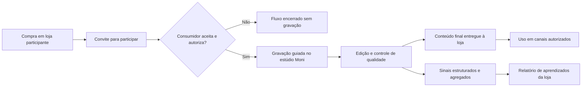

# Moni — Nova Versão da Ideia

> [!abstract] Em uma frase
> A **Moni instala estúdios compactos dentro de shopping centers** para transformar compras reais em **conteúdo pronto para uso pelas lojas** e em **aprendizado sobre como consumidores percebem, descrevem e usam seus produtos**.

> [!important] Relação com o projeto anterior
> Esta nota **não substitui nem invalida** o projeto e os estudos existentes no vault. Ela registra uma nova formulação construída sobre a base da [[Especificações do Projeto|LiveHub]]. O conteúdo anterior continua como histórico, repertório e fonte de hipóteses. A Moni deve ser tratada, por enquanto, como uma **evolução estratégica em discovery**, e não como uma decisão já validada.

> [!warning] Nomenclatura a confirmar
> O vault usa **LiveHub** como nome histórico. No briefing desta nova versão também apareceu **LifeHub**. Como não há evidência de que sejam oficialmente o mesmo nome, este documento considera **LiveHub** a referência registrada no vault e **Moni** o novo nome de trabalho. A relação jurídica e de marca entre esses nomes ainda precisa ser definida.

## 1. A nova tese

A Moni opera estandes-estúdio em pontos de circulação de shopping centers. Depois que uma pessoa compra em uma loja participante, ela é convidada a produzir um conteúdo curto sobre aquela compra. Esse conteúdo pode assumir dois formatos principais:

1. **Produto em uso:** a pessoa mostra, experimenta ou demonstra o produto que acabou de comprar.
2. **Depoimento pós-compra:** a pessoa conta por que escolheu o produto, o que chamou atenção e qual expectativa tem sobre ele.

A Moni conduz a gravação, cuida da captação, obtém as autorizações necessárias, edita o material e entrega à loja um **vídeo final pronto para publicação ou campanha**. Além do conteúdo, a operação organiza aprendizados agregados sobre o público: argumentos usados, atributos mais citados, dúvidas recorrentes, ocasiões de uso e padrões de reação.

O cliente pagante é a **loja ou marca**. O consumidor participa como protagonista do conteúdo, mediante consentimento e uma proposta de incentivo que ainda deverá ser testada.

## 2. O problema que a Moni resolve

### Para a loja

- Falta de conteúdo autêntico e recorrente com consumidores reais.
- Dependência de produções pontuais, caras ou desconectadas do momento da compra.
- Dificuldade de entender a linguagem que o cliente usa para explicar sua escolha.
- Pouca visibilidade sobre quais atributos, produtos e mensagens despertam reação.
- Falta de prova social em vídeo pronta para redes sociais, anúncios e páginas de produto.

### Para o shopping

- Necessidade de oferecer experiências que conectem espaço físico e canais digitais.
- Busca por mais valor para o lojista além do fluxo de pessoas.
- Oportunidade de criar um ativo compartilhado de conteúdo e inteligência do varejo local.

### Para o consumidor

- Uma experiência breve e assistida depois da compra.
- A possibilidade de aparecer como pessoa real, e não como ator ou influenciador contratado.
- Recebimento do próprio conteúdo, quando isso fizer parte da oferta.
- Incentivo ou benefício pela participação, a ser validado antes de ser padronizado.

## 3. O que a Moni vende

> [!tip] Unidade de valor
> A Moni não vende simplesmente “tempo de estúdio”. Ela entrega **conteúdo final aprovado + inteligência acionável sobre o consumidor**.

A oferta B2B pode ser organizada em três camadas:

### Camada 1 — Produção

- convite e abordagem do comprador elegível;
- roteiro curto conduzido por host ou operador;
- captação de vídeo e áudio;
- edição, legenda e acabamento visual;
- entrega do arquivo final nos formatos combinados;
- gestão do consentimento e do direito de uso de imagem.

### Camada 2 — Curadoria e distribuição

- classificação dos conteúdos por produto, campanha, loja e formato;
- seleção das melhores peças para cada canal;
- sugestões de uso em social orgânico, mídia paga, telas da loja ou página de produto;
- publicação ou impulsionamento somente quando contratado e tecnicamente permitido.

### Camada 3 — Estudo do público

- atributos do produto mais mencionados espontaneamente;
- motivos declarados de escolha;
- objeções, dúvidas e expectativas recorrentes;
- linguagem real usada pelos compradores;
- formatos e roteiros com maior taxa de aprovação ou engajamento;
- comparação por período, produto, categoria ou campanha.

> [!warning] Limite do “estudo”
> No início, isso deve ser apresentado como **inteligência observacional gerada pela operação**, não como pesquisa de mercado representativa. A amostra será composta por compradores convidados que aceitaram gravar, portanto haverá viés de seleção. Qualquer promessa estatística depende de método, tamanho de amostra e governança de dados ainda não definidos.

## 4. Como funciona

### Jornada operacional mínima

1. A loja identifica uma compra elegível e convida o cliente.
2. O cliente recebe uma explicação clara sobre formato, duração, incentivo e uso de imagem.
3. A participação só avança após consentimento válido.
4. Um roteiro curto ajuda o cliente a demonstrar o produto ou contar sua experiência sem fabricar elogios.
5. A Moni grava, edita e revisa o conteúdo.
6. A loja recebe apenas as peças aprovadas dentro do prazo contratado.
7. Os sinais da operação são organizados de forma agregada para gerar aprendizado, respeitando a finalidade autorizada.

## 5. Princípios do produto

- **Compra real como ponto de partida:** o conteúdo nasce de uma transação ocorrida, não de um casting disfarçado.
- **Autenticidade sem depoimento forçado:** o roteiro organiza a fala, mas não dita uma opinião positiva.
- **Conteúdo utilizável:** a entrega precisa chegar pronta, correta e adaptada ao canal acordado.
- **Operação simples antes de automação:** edição assistida por IA pode reduzir tempo, mas não substitui controle de qualidade e consentimento.
- **Dados com contexto:** observações da operação não devem ser vendidas como verdade sobre todo o mercado.
- **Valor para a loja antes de escala:** renovação e uso real do conteúdo importam mais do que volume bruto de gravações.

## 6. O que muda em relação à LiveHub

| Dimensão | Tese registrada da LiveHub | Nova formulação Moni |
|---|---|---|
| Produto central | Estúdio de live commerce e plataforma de aquisição | Estúdio de conteúdo pós-compra e inteligência do consumidor |
| Entrega principal | Depoimentos, lives, distribuição e vendas rastreadas | Vídeos finais utilizáveis + aprendizados agregados sobre o público |
| Momento | Compra gera conteúdo e pode alimentar streaming | Compra gera uma experiência de gravação curta e uma peça final |
| Canal | TikTok, Kwai, Instagram, YouTube e live shopping | Canais escolhidos pela loja; live não é requisito inicial |
| Receita | Mensalidades, comissões, afiliados, publicidade e parceria com shopping | Pagamento da loja por produção/pacote e, potencialmente, assinatura de inteligência |
| Tecnologia | Automação de postagem, streaming, afiliados e software | Fluxo de captação, consentimento, edição, biblioteca e análise |
| Métrica central | Alcance, tráfego, cupons e vendas | Conteúdo aprovado e usado, tempo de entrega, custo por peça e renovação |

### O que permanece da tese anterior

- o estúdio dentro do shopping;
- a transformação do comprador real em mídia;
- a autenticidade como diferencial;
- o shopping como ambiente de aquisição física;
- o valor do banco de dados gerado pela operação;
- a necessidade de validar adesão do consumidor e ROI do lojista antes de escalar.

### O que passa a ser opcional ou posterior

- transmissão ao vivo;
- programa de afiliados;
- comissão sobre vendas;
- distribuição automática multiplataforma;
- software próprio complexo;
- expansão para muitos estúdios antes da validação do piloto.

Esses elementos continuam documentados em [[Modelo de Negócio e Monetização]], [[Regras de Plataforma — TikTok LIVE]] e [[Matriz de Riscos]], mas não precisam fazer parte do primeiro produto Moni.

## 7. Modelo comercial inicial — hipótese de trabalho

O formato de cobrança ainda não está definido. Três possibilidades devem ser testadas com lojistas, sem assumir antecipadamente qual vencerá:

1. **Por conteúdo aprovado:** a loja paga por cada vídeo final entregue e aceito.
2. **Pacote mensal:** quantidade contratada de vídeos, com prazo de entrega e relatório básico.
3. **Conteúdo + inteligência:** pacote recorrente com vídeos e relatório periódico de aprendizados.

Uma taxa de implantação, patrocínio do shopping ou modelo híbrido pode existir, mas não deve ser tratado como receita garantida. As faixas financeiras do vault foram construídas para outra configuração operacional e **não devem ser reaproveitadas automaticamente como preço ou orçamento da Moni**. Ver [[Orçamento do MVP]] e [[Estrutura de Custos por Área]].

## 8. MVP recomendado para a Moni

> [!success] Testar o serviço antes de construir o estande definitivo
> Rodar um piloto temporário e de baixo investimento dentro de um shopping ou em área cedida por uma loja, com **2 a 3 lojas participantes**, operação manual assistida e período curto. O objetivo é descobrir se consumidores participam, se as lojas usam o conteúdo e se pagariam pela continuidade.

### Escopo sugerido

- 1 ponto de gravação temporário;
- 2 a 3 lojas com categorias diferentes;
- 2 formatos: produto em uso e depoimento pós-compra;
- 2 ou 3 incentivos testados;
- roteiro e termo de consentimento padronizados;
- edição manual assistida por IA;
- entrega direta à loja, sem depender de live ou automação de postagem;
- relatório simples de aprendizados ao final do piloto.

### Métricas que decidem o avanço

- clientes convidados por compra elegível;
- taxa de aceitação da gravação;
- taxa de conclusão e de autorização de uso;
- tempo médio entre convite, gravação e entrega;
- percentual de vídeos aprovados pela loja sem refação;
- percentual de peças efetivamente publicadas ou usadas pela loja;
- custo operacional por conteúdo aprovado;
- satisfação do consumidor participante;
- avaliação de utilidade do relatório pela loja;
- intenção real de pagamento e renovação do lojista.

Metas numéricas só devem ser fixadas depois de uma linha de base real. A antiga meta de 200 vídeos no primeiro mês, registrada em [[Hipóteses e Validação]], não deve ser transportada para a Moni sem recalcular capacidade e demanda.

## 9. Hipóteses críticas

1. Compradores aceitam participar logo após a compra quando a proposta é clara e o esforço é baixo.
2. A loja considera o conteúdo final bom o suficiente para usar em seus canais.
3. O valor do conteúdo e dos aprendizados justifica um pagamento recorrente.
4. A operação consegue entregar velocidade sem sacrificar qualidade ou consentimento.
5. O shopping aceita ceder ou comercializar um ponto com fluxo adequado.
6. O “estudo do público” produz decisões úteis sem prometer representatividade que a amostra não possui.
7. O incentivo ao consumidor não torna a percepção artificial nem destrói a autenticidade do depoimento.

## 10. Riscos e salvaguardas

### Consentimento, imagem e publicidade

- termo de uso de imagem e voz com finalidade, canais, prazo e possibilidade de retirada claramente definidos;
- cuidado especial com menores de idade;
- identificação de conteúdo incentivado ou publicitário quando exigida;
- processo para reprovar, retirar ou arquivar conteúdo inadequado.

### Privacidade e estudo do público

- coletar apenas o necessário;
- separar dados pessoais dos aprendizados agregados;
- não vender dados individuais do consumidor;
- definir retenção, acesso e descarte;
- validar a operação com assessoria jurídica antes do piloto público.

### Qualidade e reputação

- não induzir elogios falsos;
- dar ao consumidor clareza sobre o que será publicado;
- permitir que a loja defina limites de marca sem transformar a fala em propaganda roteirizada;
- manter revisão humana antes da entrega final.

### Viabilidade econômica

- medir o custo completo por vídeo aprovado, incluindo abordagem, gravação, edição, refação e gestão de direitos;
- separar interesse verbal de disposição real de pagar;
- não construir estrutura permanente antes de provar uso e renovação.

## 11. Posicionamento

### Definição curta

**Moni é a infraestrutura de conteúdo e inteligência do varejo físico, instalada onde a compra acontece.**

### Promessa para a loja

**Transformamos clientes reais em conteúdo pronto para sua marca — e cada gravação em aprendizado sobre como seu produto é percebido.**

### O que a Moni não deve prometer agora

- aumento garantido de vendas;
- pesquisa estatisticamente representativa;
- automação completa de publicação;
- volume de conteúdo sem validação de capacidade;
- exclusividade ou direitos sobre dados que não estejam previstos em consentimento e contrato;
- viabilidade financeira baseada nas projeções antigas da LiveHub.

## 12. Decisões em aberto

- Moni será uma nova empresa, uma marca, um produto ou uma evolução formal da LiveHub?
- O nome histórico correto a preservar é LiveHub ou LifeHub?
- Quem contrata e paga: loja individual, marca, shopping ou uma combinação?
- A cobrança será por peça, pacote mensal ou assinatura com inteligência?
- Quem oferece e financia o incentivo ao consumidor?
- Quais categorias de loja são mais adequadas para o primeiro piloto?
- O vídeo pertence à loja, é licenciado por prazo ou tem uso compartilhado?
- O consumidor recebe e pode publicar o conteúdo?
- Qual é o prazo de entrega aceitável para o vídeo final?
- Quais dados serão coletados, por quanto tempo e com qual base legal?
- Qual é o limite entre relatório operacional e pesquisa de mercado?
- Quais critérios objetivos autorizam investir em um estande permanente?

## 13. Próximo passo recomendado

1. Entrevistar 5 a 10 lojistas sobre formato de entrega, uso real e disposição de pagar.
2. Selecionar 2 a 3 lojas para um piloto curto.
3. Definir o termo de consentimento, o roteiro e dois formatos de vídeo.
4. Operar manualmente e medir toda a jornada.
5. Avaliar uso real do conteúdo e intenção de renovação.
6. Somente depois definir preço, estrutura permanente e eventual camada de software.

---

## Referências internas preservadas

- [[Especificações do Projeto]] — visão consolidada da LiveHub.
- [[Conceito e Proposta de Valor]] — tese do comprador real como mídia.
- [[Modelo de Negócio e Monetização]] — receitas e extensões anteriormente consideradas.
- [[Plano Operacional]] — base do fluxo e da estrutura física.
- [[Hipóteses e Validação]] — riscos de adesão e método de validação.
- [[Matriz de Riscos]] — riscos operacionais, comerciais, legais e tecnológicos.
- [[Orçamento do MVP]] — estimativas antigas, que precisam ser refeitas para o novo escopo.
- [[Análise Crítica]] — recomendação de validar antes de automatizar e escalar.

